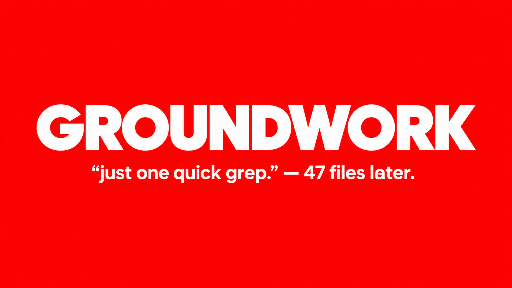

# Groundwork MCP

<p align="center">
  
</p>

<div align="center">

**Your AI can’t understand a codebase it can’t find its way around.**

Groundwork builds a searchable, cited map of a project so an MCP-compatible assistant can answer questions using the project’s actual files.

[](https://python.org)
[](LICENSE)
[](https://github.com/ARYANRAJ1121/groundwork-mcp/actions)
[](https://pypi.org/project/groundwork-mcp/)

[Install the VS Code extension](https://marketplace.visualstudio.com/items?itemName=groundwork-mcp.groundwork-mcp) · [Quick-start guide](extensions/vscode/README.md) · [Report an issue](https://github.com/ARYANRAJ1121/groundwork-mcp/issues)

</div>

---

When you ask an AI assistant about a large project, it may not know which files contain the answer. Groundwork indexes a workspace or GitHub repository, then lets a connected assistant search the code and inspect relevant files. Answers can point back to a repository, commit, file, and line range, so you can check the evidence yourself.

**Groundwork makes the project searchable; your assistant uses the search results to answer.** It does not guarantee that an AI interpretation is correct, so follow citations when accuracy matters.

Ask questions like:

- “Where is user authentication handled?”
- “What calls `create_session`?”
- “Which files configure the database?”
- “Show me the code that retries a failed request.”

## Get started

Choose one way to run Groundwork:

### VS Code or Cursor workspace

1. Install [Groundwork MCP from the VS Code Marketplace](https://marketplace.visualstudio.com/items?itemName=groundwork-mcp.groundwork-mcp).
2. Open a project folder. Groundwork’s **G** icon appears in the Activity Bar; open it to see indexing status or start indexing again.
3. Connect your AI assistant to the local Groundwork MCP server using the [quick-start guide](extensions/vscode/README.md).
4. Ask the assistant a question about the project and check the file and line citations it returns.

The extension creates the index. The separate MCP connection lets an assistant such as Claude or another compatible client search it. Installing the extension alone does not connect every assistant automatically.

### Claude Code

Requirements: Python 3.11+ and [`uv`](https://docs.astral.sh/uv/getting-started/installation/).

```bash
claude mcp add --scope user groundwork -- uvx --from groundwork-mcp groundwork-mcp
```

Then open a project in Claude Code and ask it to index that repository or workspace. `uvx` downloads and runs the published package when needed.

### Other MCP clients

Add this server to the client’s MCP configuration:

```json
{
  "mcpServers": {
    "groundwork": {
      "command": "uvx",
      "args": ["--from", "groundwork-mcp", "groundwork-mcp"]
    }
  }
}
```

For Claude Desktop, put the entry inside `mcpServers` in its configuration file, then restart Claude Desktop. On Windows the file is `%APPDATA%\Claude\claude_desktop_config.json`; on macOS it is `~/Library/Application Support/Claude/claude_desktop_config.json`.

## What Groundwork gives your assistant

Groundwork parses supported project files, stores a searchable index in SQLite, and exposes MCP tools to:

- Search source and documentation with ranked full-text search.
- Find functions, classes, and other extracted symbols.
- Read specific line ranges instead of loading an entire file.
- Explore file lists, imports, and function call relationships.
- Inspect a project summary and indexing progress.

Search and source results include structured evidence such as the repository, indexed commit, path, and line range where available. An optional local Ollama model can add semantic search; keyword search works without it.

## Local-first by default

For local workspace indexing, files are read by the Groundwork process on your machine and the index is stored in `~/.groundwork/groundwork.db` by default. Groundwork does not upload local workspace source to a hosted indexing service. Your connected AI client still receives the search results it requests, so review that client’s own data and privacy settings.

Remote GitHub repository ingestion downloads the selected repository snapshot from GitHub. Private GitHub repositories can be indexed in local mode with a read-only token supplied through `GROUNDWORK_GITHUB_TOKEN`; the token is not stored in the database. See [configuration and deployment](docs/deployment.md) for remote HTTP mode and OAuth details.

## Optional: semantic search

FTS5 keyword search is ready without extra services. To enable local semantic or hybrid search, install [Ollama](https://ollama.com), pull an embedding model, and build the index for a repository snapshot:

```bash
ollama pull nomic-embed-text
# Call index_semantic(job_id) using your MCP client.
# Then use search_code with mode="semantic" or mode="hybrid".
```

Embeddings are generated by your local Ollama service and stored in the local SQLite database.

## Supported languages

Groundwork uses tree-sitter grammars for 40+ common programming and configuration languages, including Python, JavaScript/TypeScript, Go, Java, Rust, C/C++, C#, Ruby, PHP, Kotlin, Swift, SQL, HTML, CSS, YAML, JSON, Markdown, and Terraform. Symbol extraction depth varies by language; raw-text search is available for indexed text files.

## For contributors

Requirements: Python 3.11+ and `uv`.

```bash
git clone https://github.com/ARYANRAJ1121/groundwork-mcp.git
cd groundwork-mcp
uv sync --extra router
uv run groundwork-mcp
```

The server uses stdio by default, as expected by local MCP clients. For development details, run the CI checks locally and see the [deployment guide](docs/deployment.md). VS Code extension source and build instructions are in [`extensions/vscode`](extensions/vscode/README.md).

## Project links

- [Source code](https://github.com/ARYANRAJ1121/groundwork-mcp)
- [VS Code Marketplace](https://marketplace.visualstudio.com/items?itemName=groundwork-mcp.groundwork-mcp)
- [PyPI package](https://pypi.org/project/groundwork-mcp/)
- [Deployment guide](docs/deployment.md)
- [Issues and feature requests](https://github.com/ARYANRAJ1121/groundwork-mcp/issues)

## License

MIT. See [LICENSE](LICENSE).
