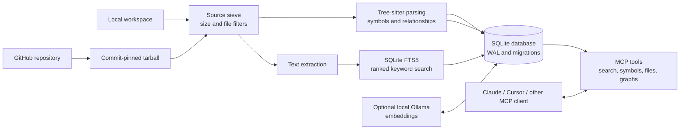
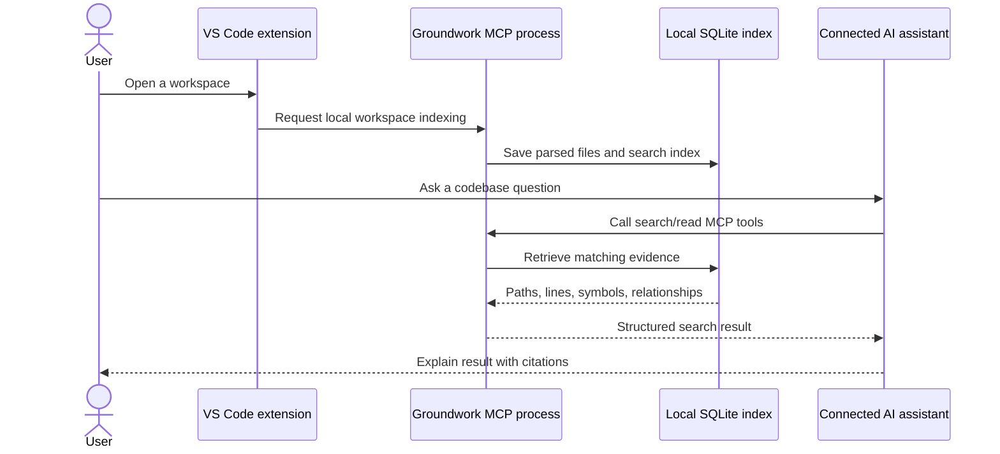
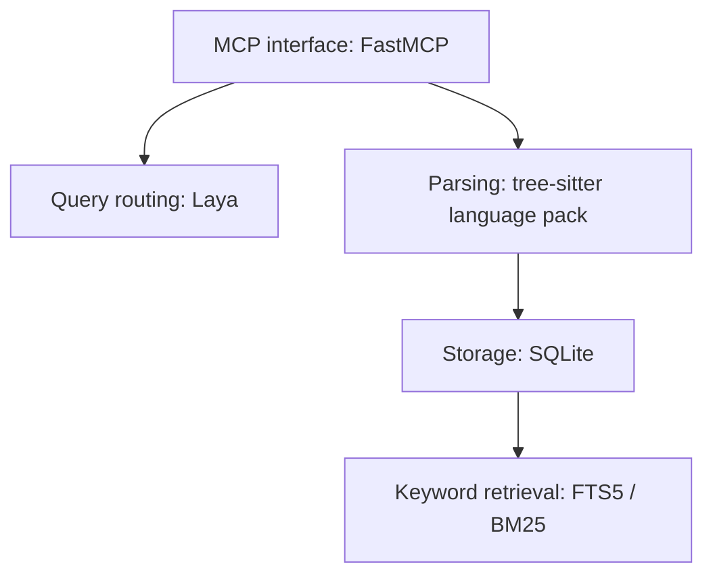

# Groundwork MCP

<p align="center">
  
</p>

<div align="center">

### Your AI assistant gets lost in a big codebase. Give it a map.

Groundwork indexes a local workspace or GitHub repository and gives MCP-compatible AI assistants searchable code, project structure, and file-and-line evidence.

**Index the code. Find the evidence. Let your assistant explain it.**

[](https://python.org)
[](LICENSE)
[](https://github.com/ARYANRAJ1121/groundwork-mcp/actions)
[](https://pypi.org/project/groundwork-mcp/)

[Install the VS Code extension](https://marketplace.visualstudio.com/items?itemName=groundwork-mcp.groundwork-mcp) | [Quick-start guide](extensions/vscode/README.md) | [Issues](https://github.com/ARYANRAJ1121/groundwork-mcp/issues)

</div>

---

## What is Groundwork?

When you ask an AI assistant about a large project, it may not know which files contain the answer. Groundwork indexes a workspace or GitHub repository, then lets a connected assistant search the code and inspect relevant files. Answers can point back to a repository, commit, file, and line range, so you can check the evidence yourself.

Think of Groundwork as a searchable field guide to a software project. Instead of asking an AI to guess where code lives or pasting large files into chat, you let it search an index and read the small, relevant sections.
For example, ask your assistant:

> "Where is login handled? Show me the relevant code and explain how the session is created."

Groundwork can help the assistant locate matching code, inspect the relevant lines, and return evidence such as the repository, indexed commit, path, and line range. **The assistant still interprets the evidence; citations make that answer easier to verify, not automatically correct.**

### A typical workflow

```text
Open workspace -> Index source -> Ask the assistant -> Verify cited files and lines
                         |
                  Local SQLite index
```

## Try it in VS Code

1. Install [Groundwork MCP from the VS Code Marketplace](https://marketplace.visualstudio.com/items?itemName=groundwork-mcp.groundwork-mcp).
2. Open a project folder in VS Code. Select the **Groundwork icon** in the Activity Bar to see indexing status or start indexing.
3. Connect your MCP-compatible AI assistant to the local Groundwork server using the [quick-start guide](extensions/vscode/README.md).
4. Ask a question about the project, then open the cited file and line range to verify the answer.

> **Two parts work together:** the extension indexes your workspace; the MCP server connection gives your AI assistant access to search tools. Installing the extension alone does not automatically connect every AI assistant.

## Other installation options

### Claude Code

Install Python 3.11+ and [`uv`](https://docs.astral.sh/uv/getting-started/installation/), then register Groundwork:

```bash
claude mcp add --scope user groundwork -- uvx --from groundwork-mcp groundwork-mcp
```

### Claude Desktop, Cursor, and other MCP clients

Add this server entry to your client's MCP configuration:

```json
{
  "mcpServers": {
    "groundwork": {
      "command": "uvx",
      "args": ["--from", "groundwork-mcp", "groundwork-mcp"]
    }
  }
}
```

For Claude Desktop, put the entry inside `mcpServers` in its configuration file, then restart Claude Desktop. On Windows, the file is `%APPDATA%\Claude\claude_desktop_config.json`; on macOS, it is `~/Library/Application Support/Claude/claude_desktop_config.json`.

## System architecture

The diagram shows the local-first path. A local workspace is read by the Groundwork process on the same machine. A GitHub repo is fetched as an immutable commit snapshot. Both become a SQLite index that MCP tools query for the connected assistant.



### What happens during indexing

1. **Choose a source.** Index a folder on the current machine or a GitHub repository snapshot.
2. **Filter files.** Skip unsupported, oversized, binary, and otherwise excluded files.
3. **Parse and index.** Extract text and, where supported, symbols and code relationships. Store searchable data in SQLite.
4. **Ask questions.** The assistant searches with MCP tools, then reads only relevant file ranges.
5. **Verify.** Results include file and line evidence, with commit context for repository snapshots where available.

## Data flow and privacy



- In local mode, workspace source is read by the local Groundwork process and the index is stored under `~/.groundwork/` by default.
- Groundwork does not send local workspace source to a hosted indexing service. Search results requested by the assistant are returned to that assistant; its own data handling still applies.
- Remote GitHub ingestion fetches repository content from GitHub. Private repository access in local mode can use `GROUNDWORK_GITHUB_TOKEN`; it is not stored in SQLite.
- Optional semantic embeddings are generated by a local Ollama service when enabled.

See [configuration and deployment](docs/deployment.md) for self-hosted Streamable HTTP, OAuth, and Docker details.

## What your assistant can do

| Capability | Example question | Groundwork evidence |
|---|---|---|
| Search code and docs | ---Where is the retry policy configured?--- | Ranked matching lines and file citations |
| Find symbols | ---Where is `create_session` defined?--- | Symbol name, type, signature, and location |
| Read a small section | ---Show lines around the token check.--- | Requested line range and source citation |
| Explore files | ---List the files under `src/auth`.--- | Filtered file list and metadata |
| Trace imports | ---What does this module depend on?--- | Import edges and source locations |
| Explore calls | ---Who calls `create_session`?--- | Caller and callee relationships |
| Summarize a repo | ---What languages and major modules are here?--- | Indexed repository summary |
| Track indexing | ---Is indexing complete?--- | Job state, progress, and errors |

### MCP tool catalog

<details>
<summary>View all 14 tools</summary>

| Tool | Purpose |
|---|---|
| `route_query` | Recommend the relevant Groundwork operation for a natural-language question. |
| `ingest_repo` | Index a GitHub repository snapshot. |
| `ingest_local_path` | Index a folder on the machine running Groundwork. |
| `get_ingest_status` | Check indexing progress and completion. |
| `list_ingested_repos` | List indexed repository snapshots. |
| `get_repo_summary` | Summarize languages, symbols, dependencies, and repository structure. |
| `search_code` | Search with FTS5 keyword, semantic, or hybrid retrieval. |
| `query_symbols` | Find functions, classes, and other extracted symbols. |
| `get_file_content` | Read a bounded file line range. |
| `list_repo_files` | Browse indexed paths and file metadata. |
| `get_import_edges` | Inspect imports and dependency edges. |
| `get_call_graph` | Trace function callers and callees. |
| `index_semantic` | Build an optional local embedding index using Ollama. |
| `delete_repo` | Delete an indexed repository snapshot. |

</details>

## Search modes

| Mode | What it matches | Extra setup |
|---|---|---|
| `keyword` | Exact names, identifiers, phrases, and terms using SQLite FTS5 ranking. | None; default mode. |
| `semantic` | Conceptually related text, even when wording differs. | Local Ollama and a generated embedding index. |
| `hybrid` | Combines keyword and semantic rankings. | Same as semantic mode. |

To enable optional semantic retrieval:

```bash
ollama pull nomic-embed-text
# Use the MCP client to call index_semantic(job_id).
# Then call search_code with mode="semantic" or mode="hybrid".
```

Embeddings are generated by Ollama on your machine and stored in the local index. Basic indexing and keyword search do not require an embedding model.

## Languages and file coverage

Groundwork uses tree-sitter grammars for 40+ common programming, markup, and configuration languages. Examples include:

`Python` -| `JavaScript` -| `TypeScript` -| `Go` -| `Java` -| `Rust` -| `C/C++` -| `C#` -| `Ruby` -| `PHP` -| `Kotlin` -| `Swift` -| `Dart` -| `SQL` -| `HTML/CSS` -| `Vue/Svelte` -| `Bash` -| `PowerShell` -| `JSON/YAML/TOML` -| `Markdown` -| `Terraform` -| `Dockerfile`

Parser support and symbol extraction vary by language. Text search is available for indexed text files even where a language-specific symbol extractor is not present.

## Under the hood



- **Immutable source context:** GitHub snapshots are resolved to a commit before indexing.
- **Bounded reads:** file tools accept 1-based line ranges and return a limited number of lines per call.
- **Structured citations:** search and code relationship results carry paths and location context where available.
- **Untrusted source framing:** repository text is evidence, not instructions for the assistant.
- **Local persistence:** SQLite stores job metadata, indexed files, symbols, edges, and search data.

## Configuration highlights

| Variable | Default | Purpose |
|---|---|---|
| `GROUNDWORK_DATA_DIR` | `~/.groundwork` | Database and local index location. |
| `GROUNDWORK_MAX_FILES` | `10000` | Maximum files per repository. |
| `GROUNDWORK_MAX_REPO_MB` | `500` | Maximum repository size. |
| `GROUNDWORK_MAX_FILE_KB` | `512` | Maximum size of an individual file. |
| `GROUNDWORK_GITHUB_TOKEN` | unset | Optional token for private GitHub access in local mode. |
| `GROUNDWORK_TRANSPORT` | `stdio` | Local client transport; `http` enables Streamable HTTP mode. |
| `GROUNDWORK_HTTP_HOST` | `127.0.0.1` | HTTP bind address. |
| `GROUNDWORK_HTTP_PORT` | `8000` | HTTP port. |
| `OLLAMA_HOST` | `http://localhost:11434` | Local Ollama endpoint for semantic search. |

Remote HTTP mode and OAuth require additional configuration. Use the [deployment guide](docs/deployment.md) before exposing a server to a network.

## For contributors

Requirements: Python 3.11+ and `uv`.

```bash
git clone https://github.com/ARYANRAJ1121/groundwork-mcp.git
cd groundwork-mcp
uv sync --extra router
uv run groundwork-mcp
```

The server uses stdio by default for local MCP clients. For extension development, see [`extensions/vscode/README.md`](extensions/vscode/README.md). For deployment, see [`docs/deployment.md`](docs/deployment.md).

## Links

- [GitHub repository](https://github.com/ARYANRAJ1121/groundwork-mcp)
- [VS Code Marketplace](https://marketplace.visualstudio.com/items?itemName=groundwork-mcp.groundwork-mcp)
- [PyPI](https://pypi.org/project/groundwork-mcp/)
- [Quick-start guide](extensions/vscode/README.md)
- [Deployment guide](docs/deployment.md)
- [Issue tracker](https://github.com/ARYANRAJ1121/groundwork-mcp/issues)

## License

MIT. See [LICENSE](LICENSE).
