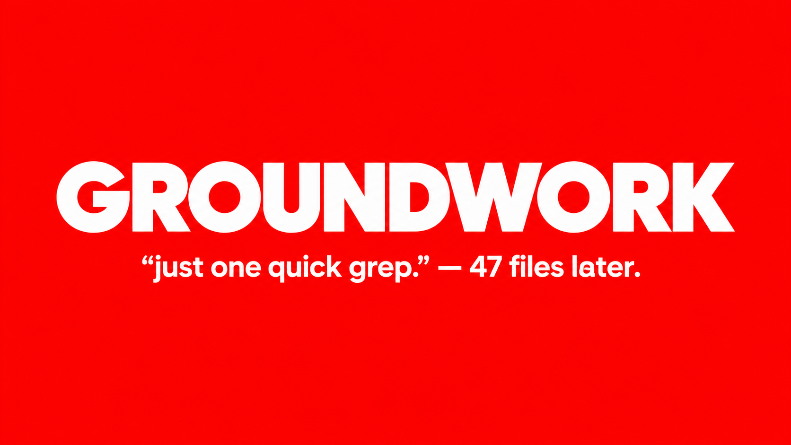

# Groundwork MCP for VS Code and Cursor

<p align="center">
  
</p>

**Understand a codebase with evidence from its files.** Groundwork indexes your open workspace locally. An AI assistant connected to Groundwork MCP can search that index and answer with file and line citations.

## First use

1. Install **Groundwork MCP** from the Marketplace.
2. Open a project folder. Groundwork starts indexing automatically.
3. Click the **Groundwork icon** in the Activity Bar to see the indexing status. Use **Index this workspace** to run it again, or **View indexing log** if setup needs attention.
4. Connect your AI assistant to Groundwork MCP using the steps below. Then ask it questions about the project.

The extension manages indexing. The separate assistant connection gives Claude, Copilot, or another MCP-compatible assistant access to Groundwork's search tools.

## What Groundwork does

Groundwork turns a project into a searchable local index of files, symbols, imports, and code relationships. Your assistant can use that evidence to answer questions such as:

- “Where is authentication configured? Show me the exact files and lines.”
- “Trace what happens when a request reaches this endpoint.”
- “Which modules call `configure_logging`?”

Groundwork returns source locations so you can verify answers against your code.

## Connect an AI assistant

You need Python 3.11+ and [`uv`](https://docs.astral.sh/uv/getting-started/installation/) available on your PATH. Groundwork runs locally with `uvx --from groundwork-mcp groundwork-mcp`.

### Claude Code

Run this once in a terminal:

```bash
claude mcp add --scope user groundwork -- uvx --from groundwork-mcp groundwork-mcp
```

Restart or open Claude Code. Confirm Groundwork is listed among its MCP servers.

### VS Code Chat / GitHub Copilot

Create `.vscode/mcp.json` in your project (or merge this server into the file if it already exists):

```json
{
  "servers": {
    "groundwork": {
      "type": "stdio",
      "command": "uvx",
      "args": ["--from", "groundwork-mcp", "groundwork-mcp"]
    }
  }
}
```

Save the file, start the Groundwork server from VS Code's MCP controls, and approve it for this workspace. Then use Agent mode and ask a code question.

### Claude Desktop

Add this server to Claude Desktop's `claude_desktop_config.json` under `mcpServers`:

```json
{
  "groundwork": {
    "command": "uvx",
    "args": ["--from", "groundwork-mcp", "groundwork-mcp"]
  }
}
```

Restart Claude Desktop after saving the file.

## Privacy

In local mode, workspace source and the Groundwork index stay on the machine running the extension and server. The extension sends the workspace path to the local Groundwork process; it does not upload the source to a Groundwork-hosted service.

## Settings and help

- `groundwork.autoIndex`: index open workspaces on startup (default: `true`).
- `groundwork.command` and `groundwork.args`: change how the local server is started.
- Run **Groundwork: Index Workspace** from the Command Palette to re-index.
- Run **Groundwork: Show Indexing Log** to inspect progress or errors.

If the dashboard says it cannot start Groundwork, install `uv`, make sure `uvx --version` works in a new terminal, then restart VS Code.

## Development

```bash
npm install
npm run compile
```

Press F5 in VS Code to launch an Extension Development Host.
